# Polaris — Feature Guide

Loans that are clear from the first step

> This guide is generated automatically on every merge: CI builds the
> app, walks the guided tour on an Android emulator, and captures
> each screen below.

## 1. Welcome to Polaris

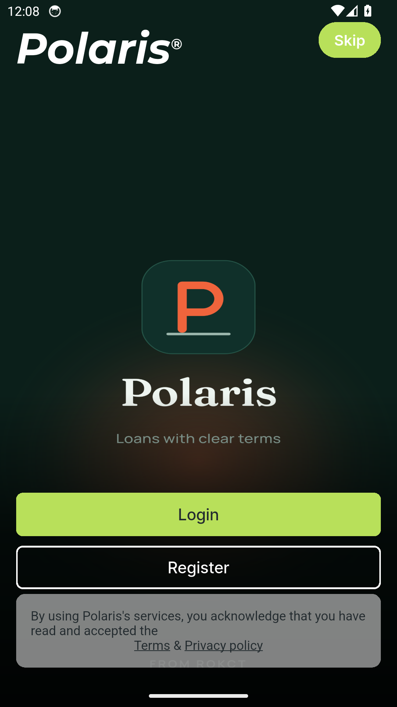

Polaris is a loan you can understand - sign in to get started.

## 2. Sign in

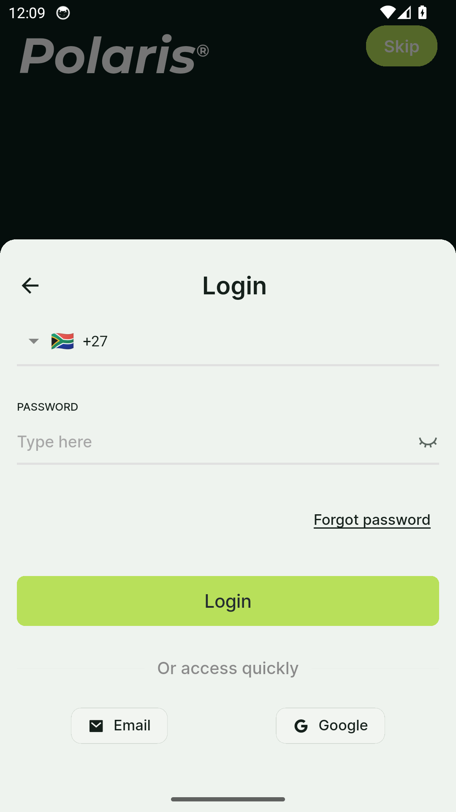

Signing in to Polaris is quick and simple.

## 3. Create an account

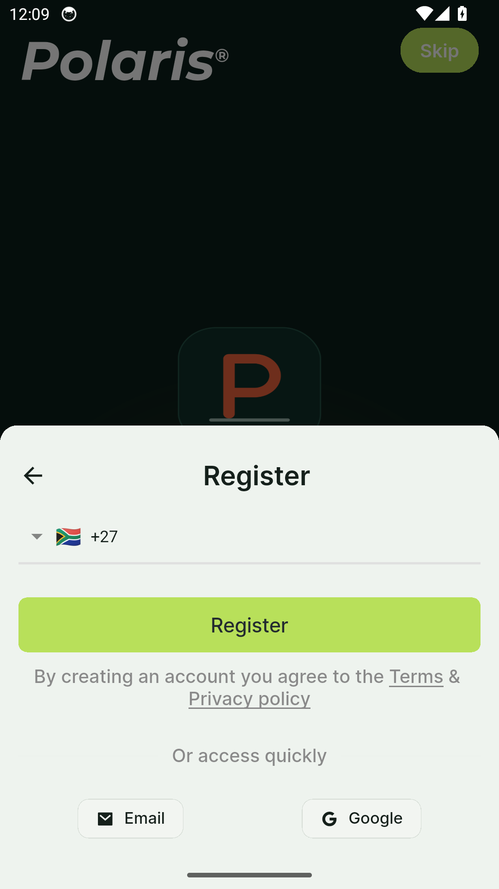

New to Polaris? Create your account in a few easy steps.

## 4. Reset your password

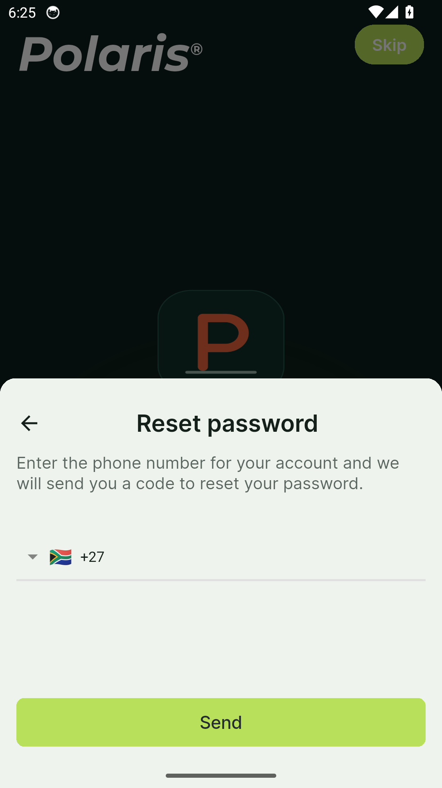

Forgot your password? Polaris gets you back in with a secure reset.

## 5. Borrow, and see your loan

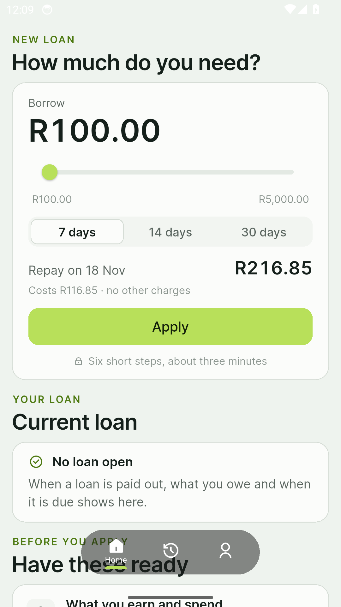

Home shows what you can borrow, your current loan and what to have ready.

## 6. Apply in minutes

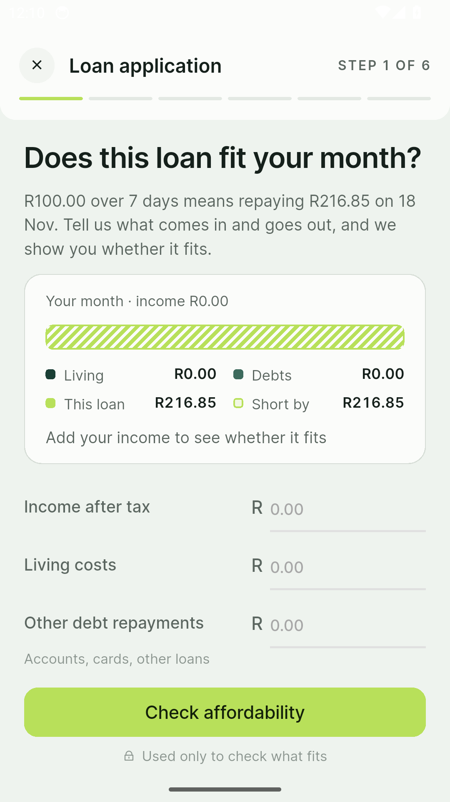

Need a loan? Polaris walks you through six clear steps - no branch, no
paperwork.

## 7. Affordability first

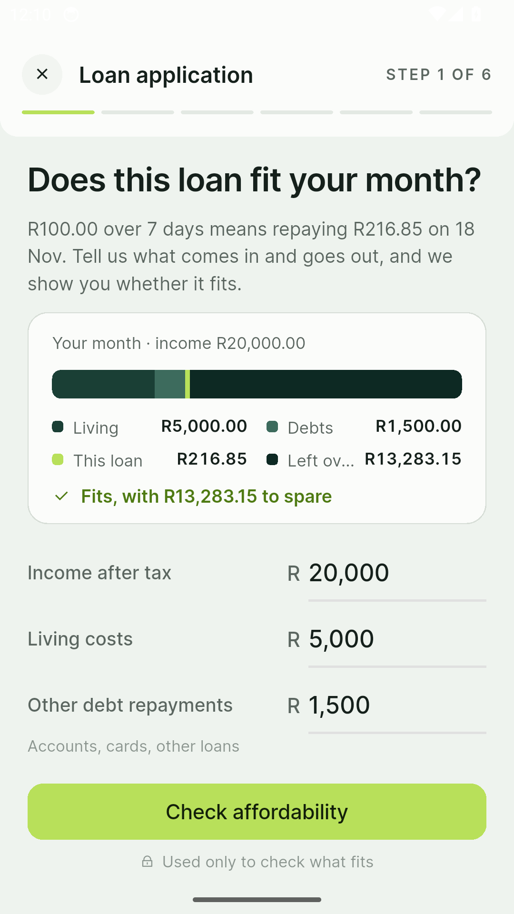

An honest affordability check comes before anything else - income in, answer
out.

## 8. Confirm your details

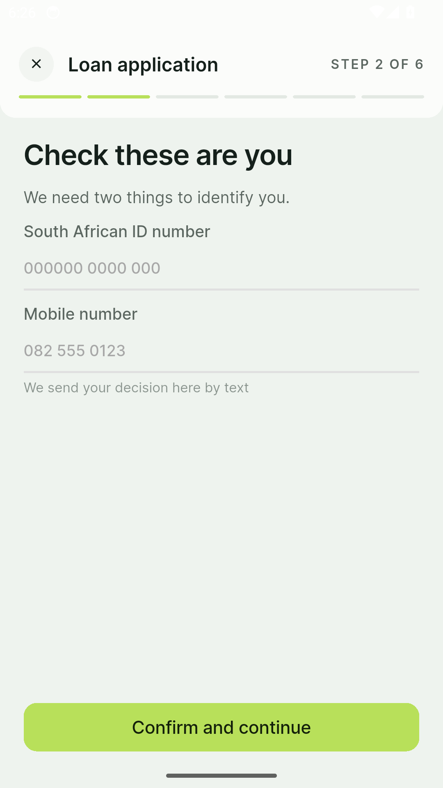

Pass the check and your details arrive prefilled - confirm and continue.

## 9. Four documents

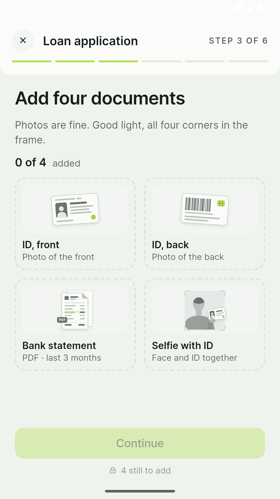

Add four documents - ID front and back, a bank statement and a selfie.

## 10. Read the agreement

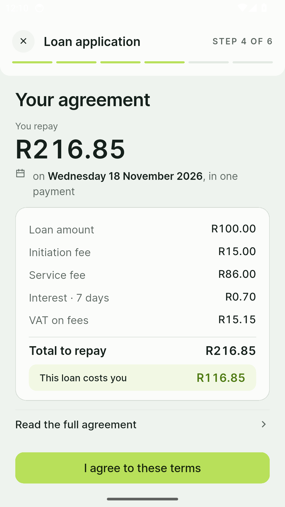

Every rand of cost is shown up front before you agree to anything.

## 11. Approve DebiCheck

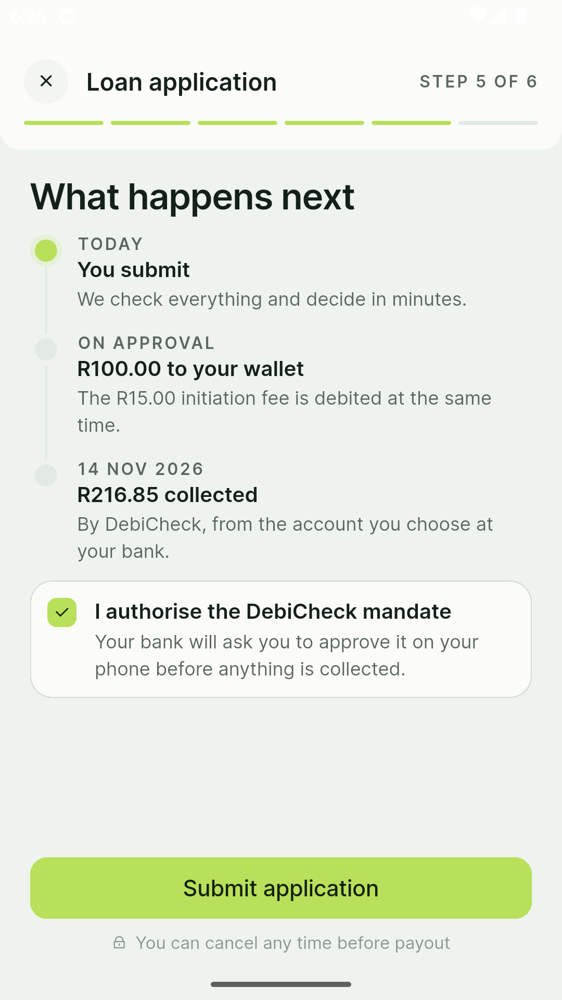

Approve the DebiCheck mandate, then submit. Nothing is paid out until you agree.

## 12. Application in review

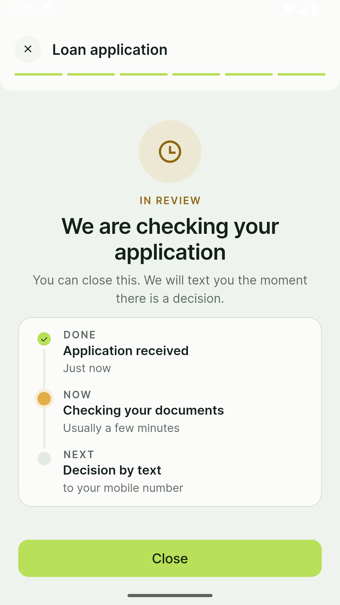

Submitted. We text you the moment there is a decision.

## 13. Every loan in one place

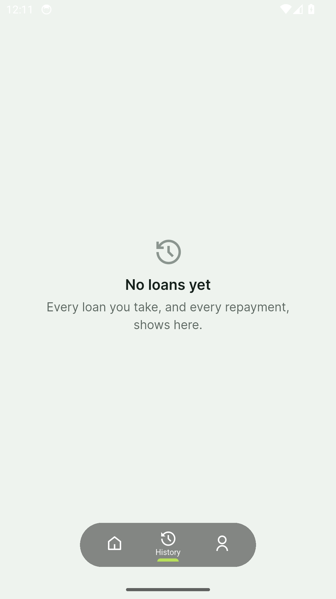

History lists every loan - pick one to see what was paid out and repaid.

## 14. Your profile

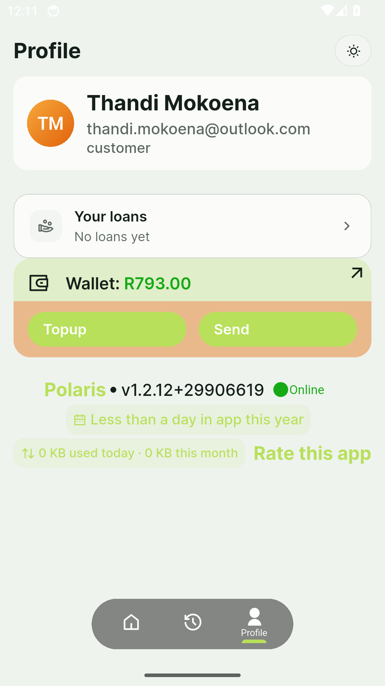

Your profile and settings, one tap away in the same nav.
