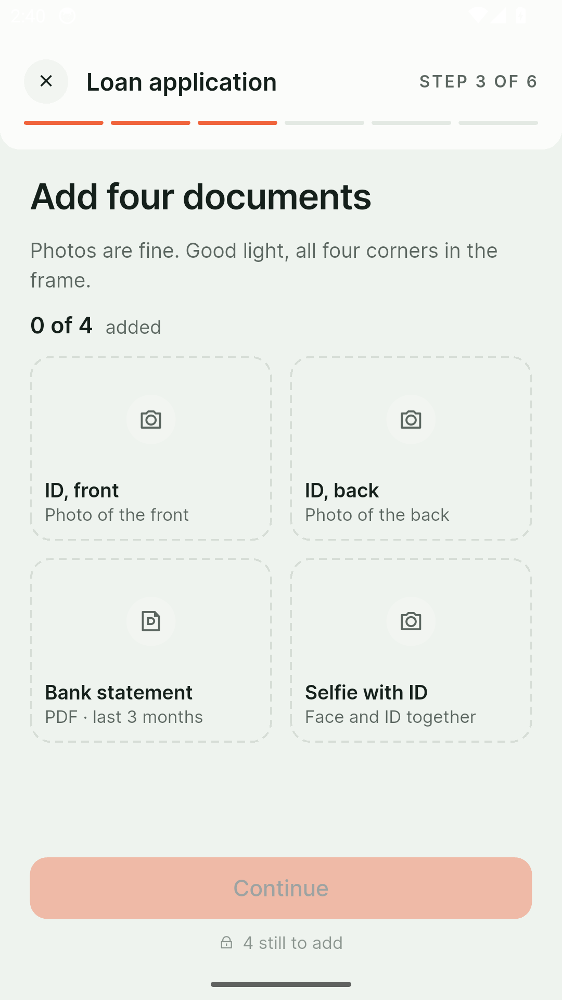
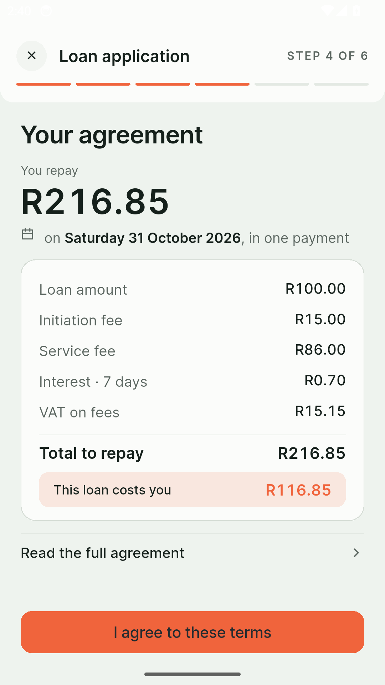
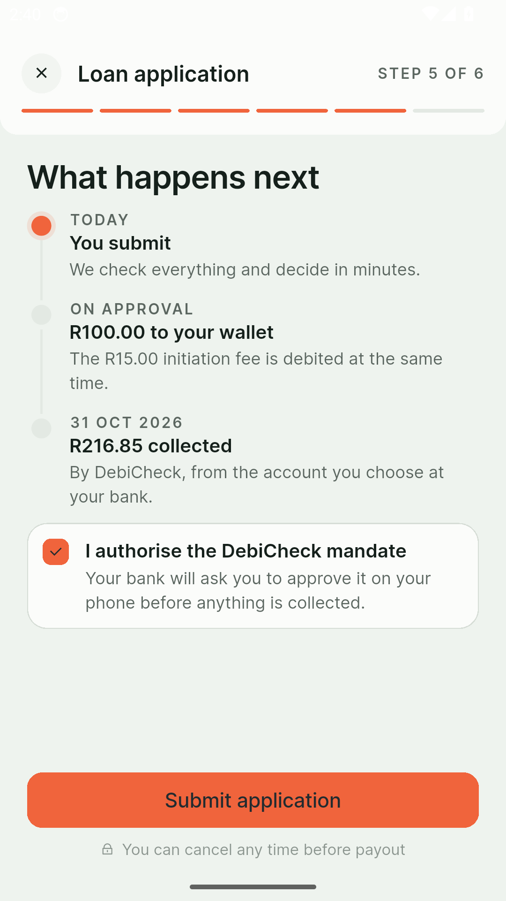
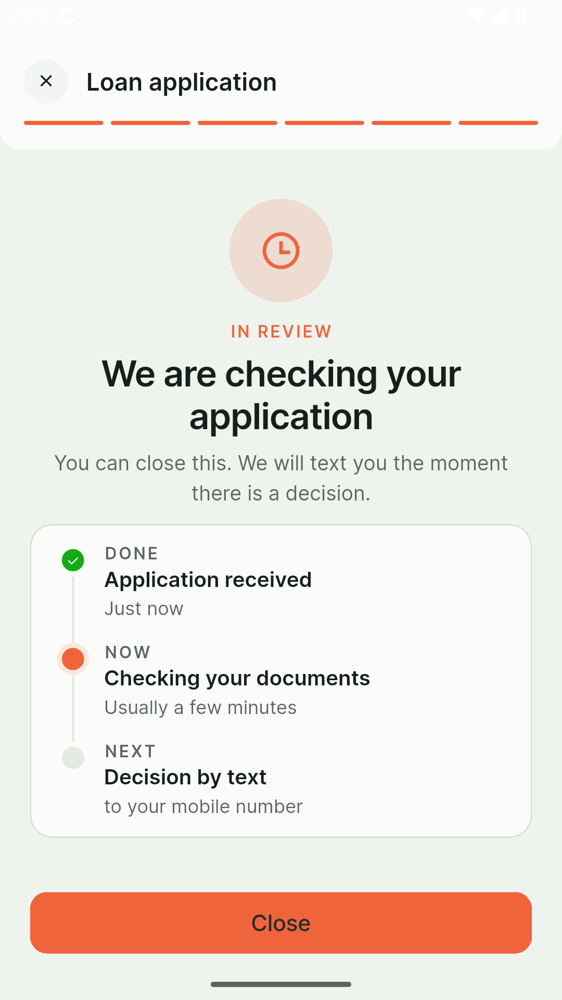

# Polaris — Feature Guide

Loans that are clear from the first step

> This guide is generated automatically on every merge: CI builds the
> app, walks the guided tour on an Android emulator, and captures
> each screen below.

## 1. Welcome to Polaris

Polaris is a loan you can understand - sign in to get started.

## 2. Sign in

Signing in to Polaris is quick and simple.

## 3. Create an account

New to Polaris? Create your account in a few easy steps.

## 4. Reset your password

Forgot your password? Polaris gets you back in with a secure reset.

## 5. Apply in minutes

Need a loan? Polaris walks you through six clear steps - no branch, no
paperwork.

## 6. Affordability first

An honest affordability check comes before anything else - income in, answer
out.

## 7. Confirm your details

Pass the check and your details arrive prefilled - confirm and continue.

## 8. Four documents

Add four documents - ID front and back, a bank statement and a selfie.

## 9. Read the agreement

Every rand of cost is shown up front before you agree to anything.

## 10. Approve DebiCheck

Approve the DebiCheck mandate, then submit. Nothing is paid out until you agree.

## 11. Application in review

Submitted. We text you the moment there is a decision.
